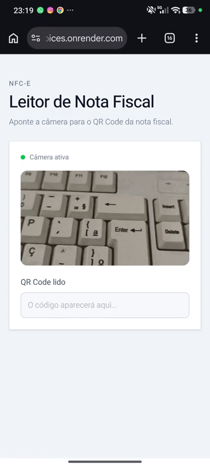

# Purchase Invoices

A full-stack application for scanning Brazilian electronic consumer invoices (NFC-e) through QR Codes, extracting product information, and recording purchases in a PostgreSQL database.

The project combines a React frontend with a Java and Spring Boot backend, providing a REST API for invoice processing, product validation, and purchase persistence.

## Demo




**Live application:** [https://purchase-invoices.onrender.com/](https://purchase-invoices.onrender.com/)

## Features

- **QR Code Scanning:** Scan NFC-e QR Codes using the device camera.
- **Invoice Data Extraction:** Retrieve invoice information from the URL encoded in the QR Code.
- **HTML Parsing:** Extract invoice and product information from the SEFAZ consultation page.
- **Data Validation:** Validate product information, including quantity and price consistency.
- **Duplicate Prevention:** Check invoice access tokens to prevent duplicate registrations.
- **Product Management:** Reuse previously registered products and save new ones.
- **Purchase Records:** Associate products with invoices and store quantities, prices, and purchase dates.
- **Anonymous Sessions:** Protect API endpoints through HTTP sessions without requiring user registration.
- **Rate Limiting:** Limit excessive requests to help protect the API.

## Technologies

### Backend

|Technology|Purpose|
|---|---|
|Java 21|Main programming language|
|Spring Boot 4.2.0|Application framework|
|Spring Web MVC|REST API development|
|Spring Data JPA|Data persistence|
|Spring Security|Security filter configuration|
|Hibernate|ORM and entity mapping|
|PostgreSQL|Relational database|
|Flyway|Database migrations|
|Jsoup|HTML parsing|
|Java HttpClient|HTTP requests to external invoice pages|
|Bucket4j|Rate limiting|
|Maven|Dependency management and build|

### Frontend

|Technology|Purpose|
|---|---|
|React 19|User interface|
|TypeScript|Static typing|
|Vite|Development server and build tool|
|Tailwind CSS 4|Styling|
|ZXing Browser|QR Code scanning|

### Infrastructure and Testing

- Docker
- Docker Compose
- JUnit 5
- Mockito
- Testcontainers dependencies

## Architecture

The application follows a layered backend architecture, separating HTTP requests, business logic, data access, and external HTML extraction.

```
                    Browser / Mobile
                           |
                           v
                   React + TypeScript
                           |
                           v
                      REST API
                           |
             +-------------+-------------+
             |             |             |
             v             v             v
         Controller     Security     Validation
             |
             v
           Service
             |
       +-----+----------------+
       |                      |
       v                      v
   Repository             HTML Reader
       |                      |
       v                      v
   PostgreSQL            SEFAZ Website
```

### Invoice Processing Flow

1. The frontend accesses the device camera and scans the NFC-e QR Code using ZXing.
2. The QR Code URL is sent to the backend through a REST request.
3. The backend retrieves the SEFAZ consultation page using Java HttpClient.
4. Jsoup parses the returned HTML.
5. Invoice and product information is extracted and validated.
6. The application checks whether the invoice access token has already been registered.
7. Existing products are reused, while new products are processed and saved.
8. The invoice and associated purchase records are persisted in PostgreSQL.
9. The API returns the processed invoice and its product information.

### Backend Structure

|Package|Responsibility|
|---|---|
|`config`|Security and application configuration|
|`controller`|REST API endpoints|
|`dto`|Data transfer objects|
|`exception`|Custom exceptions and error handling|
|`filter`|Anonymous session validation and rate limiting|
|`model`|JPA entities and request models|
|`repository`|Database access|
|`response`|Standardized API responses|
|`scrapper`|External HTML retrieval and extraction|
|`service`|Business rules and application logic|

## Database

PostgreSQL stores three main entities:

- **Invoice:** Stores the invoice access token and issue date.
- **Product:** Stores product information, including description, code, unit of measurement, and unit price.
- **RecordedPurchases:** Associates invoices with products, recording quantities, total prices, and purchase dates.

Flyway manages database schema migrations, while Hibernate validates the mapped entities against the database schema at application startup.

## REST API

|Method|Endpoint|Description|
|---|---|---|
|POST|`/session`|Creates an anonymous HTTP session|
|POST|`/invoices`|Processes and records an NFC-e invoice|
|GET|`/product`|Retrieves registered products|
|GET|`/product/{id}`|Retrieves a product by ID|

### Session Creation

A session must be created before accessing protected product and invoice endpoints.

**Request:**

```http
POST /session
```

The application creates an HTTP session and returns a confirmation message. The client must retain the session cookie for subsequent requests.

### Invoice Processing

**Request:**

```http
POST /invoices
Content-Type: application/json
```

```json
{
  "url": "NFC-e_QR_CODE_URL"
}
```

The endpoint retrieves the invoice page, extracts its information, validates the products, and records the purchase data.

**Response:**

Returns the invoice access token, invoice date, and associated product information.

### HTTP Status Codes

|Status|Description|
|---|---|
|`200 OK`|Request successfully processed|
|`400 Bad Request`|No valid products were extracted from the invoice|
|`401 Unauthorized`|Missing or expired anonymous session|
|`404 Not Found`|No registered products were found|
|`409 Conflict`|Invoice already registered|
|`429 Too Many Requests`|Request rate limit exceeded|

### Security and Rate Limiting

- Anonymous HTTP sessions are required for `/product` and `/invoices` endpoints.
- The rate limiter uses Bucket4j to allow up to 3 requests per minute per client IP address on protected routes.
- The application does not require user registration or a traditional username and password.

## Getting Started

### Prerequisites

- Git
- Docker
- Docker Compose

### 1. Clone the Repository

```powershell
git clone https://github.com/Kaikybiten/purchase_invoices.git

cd purchase_invoices
```

### 2. Configure Environment Variables

Create a `.env` file in the project root:

```properties
DATABASE_URL=jdbc:postgresql://postgres:5432/purchase_invoices
DATABASE_USERNAME=invoice_app
DATABASE_PASSWORD=your_password
```

Use your own database credentials.

**Note:** The hostname `postgres` refers to the PostgreSQL service inside Docker Compose. If you run the backend directly on your machine instead of inside Docker, use `localhost` as the database hostname.

### 3. Build and Start the Application

```powershell
docker compose up --build -d
```

Docker Compose starts PostgreSQL and builds the application.

The Dockerfile uses a multi-stage build:

1. Node.js 22 builds the React frontend.
2. Eclipse Temurin 21 JDK builds the Spring Boot application and packages the frontend static files.
3. Eclipse Temurin 21 JRE runs the final application image.

The final container runs the Spring Boot application as a non-root user (`appuser`), following the principle of least privilege.

### 4. Access the Application

Open:

```
http://localhost:8080
```

The frontend and backend are served by the same Spring Boot application.

### 5. Stop the Application

```powershell
docker compose down
```

This stops and removes the containers. The current Compose configuration does not declare a named PostgreSQL volume, so database persistence across container removal is not configured.

## Running Tests

Run the automated tests using the Maven Wrapper:

```powershell
./mvnw test
```

The project uses JUnit 5 and Mockito for unit testing service-layer behavior, including:

- Verifying product registration and repository interactions.
- Validating invoice response generation.
- Testing response generation with multiple products.

The Docker build currently uses `-DskipTests`, so tests are not executed during image construction.

## Project Structure

```
purchase_invoices/
├── docs/
│   └── demo.gif
├── frontend/
│   └── src/
│       ├── components/
│       │   ├── invoice/
│       │   └── reader/
│       ├── service/
│       └── types/
├── src/
│   ├── main/
│   │   ├── java/com/example/purchase_invoices/
│   │   │   ├── config/
│   │   │   ├── controller/
│   │   │   ├── dto/
│   │   │   ├── exception/
│   │   │   ├── filter/
│   │   │   ├── model/
│   │   │   ├── repository/
│   │   │   ├── response/
│   │   │   ├── scrapper/
│   │   │   └── service/
│   │   └── resources/
│   │       └── db/migration/
│   └── test/
├── Dockerfile
├── docker-compose.yml
├── pom.xml
└── README.md
```