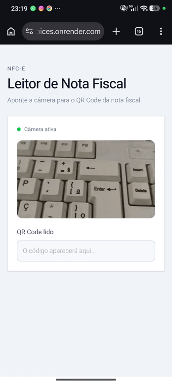

# Purchase Invoices

A full-stack application for reading Brazilian electronic consumer invoices (NFC-e) through their QR codes, extracting product information, and storing purchase records.


## Demo




## Live Demo

Try the application: [https://purchase-invoices.onrender.com/](https://purchase-invoices.onrender.com/)

The application is deployed on Render. Availability and response time may vary depending on the hosting plan.


## Features

- **QR Code Scanning:** Read NFC-e QR codes using a device's camera.
- **Invoice Processing:** Extract invoice and product information from the URL encoded in the QR code.
- **Purchase History:** Store and retrieve recorded purchases.
- **Product Management:** Persist product information in a PostgreSQL database.
- **Duplicate Detection:** Prevent the same invoice from being recorded more than once.
- **REST API:** Expose backend endpoints for invoice processing and product retrieval.
- **Containerized Deployment:** Build and run the frontend and backend in a single Docker image, with PostgreSQL managed separately.


## Tech Stack

### Backend

- Java 17
- Spring Boot 4
- Spring Web MVC
- Spring Data JPA
- Spring Security
- PostgreSQL
- Flyway
- Maven
- Jsoup
- Bucket4j

### Frontend

- React 19
- JavaScript
- Vite
- Tailwind CSS
- ZXing Browser

### Infrastructure

- Docker
- Docker Compose

## Architecture

The application uses a React frontend and a Spring Boot REST API, with PostgreSQL for persistent storage.

The Docker build uses multiple stages to compile the frontend, package the backend, and produce a smaller final Java runtime image.

```
Browser / Mobile Device
          |
          v
     React Frontend
          |
          v
   Spring Boot REST API
          |
          v
       PostgreSQL
```


## Getting Started

### Prerequisites

Install the following tools:

- Git
- Docker
- Docker Compose

You do not need to install Java, Maven, or Node.js separately when using the provided Docker setup.

### 1. Clone the repository

```
git clone https://github.com/Kaikybiten/purchase_invoices.git
cd purchase_invoices
```

### 2. Configure environment variables

Create a local `.env` file based on the example:

```
cp .env.example .env
```

Configure the database connection for Docker Compose. The database hostname must be `postgres`, which is the service name defined in `docker-compose.yml`.

```
DATABASE_URL=jdbc:postgresql://postgres:5432/purchase_invoices
DATABASE_USERNAME=invoice_app
DATABASE_PASSWORD=change_this_password
API_KEY=change_this_api_key
```

Use your own credentials for local development. Do not commit your `.env` file or expose secrets in the repository.

### 3. Start the application

Build the application image and start the containers:

```
docker compose up --build -d
```

The application will be available at:

- **Frontend:** [http://localhost:8080](http://localhost:8080/)
- **Backend API:** [http://localhost:8080](http://localhost:8080/)
- **PostgreSQL:** localhost:5432

The frontend is built into the Spring Boot application and served by the backend.

### 4. Stop the application

```
docker compose down
```

To remove the containers and the database volume, if one has been configured:

```
docker compose down -v
```

**Warning:** Removing the database volume permanently deletes the data stored in it.


## Database Migrations

Flyway manages database migrations, while Hibernate validates the database schema at application startup.

The application expects the database schema to be compatible with the migration files included in the repository.


## Project Structure

```
purchase_invoices/
├── frontend/                  # React application
│   ├── src/                   # Frontend source code
│   ├── package.json
│   └── vite.config.js
├── src/
│   └── main/
│       ├── java/              # Spring Boot application
│       └── resources/
│           ├── db/migration/  # Database migrations
│           └── static/        # Built frontend assets
├── .env.example               # Environment variable template
├── .dockerignore
├── Dockerfile                 # Multi-stage application build
├── docker-compose.yml         # Application and database services
├── mvnw                       # Maven Wrapper
└── pom.xml                    # Backend dependencies
```


## Development

### Frontend

To run the frontend separately during development:

```
cd frontend
npm ci
npm run dev
```

The development server URL is displayed in the terminal.

### Backend

To compile and package the backend:

```
./mvnw clean package
```

To run the Spring Boot application directly:

```
./mvnw spring-boot:run
```

Make sure PostgreSQL is running and the required database environment variables are configured before starting the backend.


## Deployment

The project includes a multi-stage Dockerfile suitable for container-based deployment platforms.

The build process:

1. Installs frontend dependencies and builds the React application using Node.js 22.
2. Copies the generated frontend assets into the Spring Boot static resources directory.
3. Packages the backend using Java 17.
4. Runs the packaged application using a Java 17 JRE image.

For deployment, configure the database connection and credentials through the hosting platform's environment variables. Use a persistent PostgreSQL database and keep credentials out of source control.

## Security Considerations

- Keep database credentials and API secrets out of version control.
- Use HTTPS in production.
- Restrict database access to trusted services.
- Configure appropriate request limits and security controls before exposing the application publicly.

## Author

**Kaiky Bitencourt**

- GitHub: [@Kaikybiten](https://github.com/Kaikybiten)

---

Developed as a full-stack project focused on Java, Spring Boot, React, PostgreSQL, and containerized deployment.